  

# ⚡ Awesome Terminal File Manager & CLI Productivity Ecosystem

  
  
  
  
  

---

## 🧭 Curated Guide to Terminal User Interface (TUI) File Managers, Dual-Pane Commanders & Modern CLI File Utilities

> Comprehensive directory covering both high-performance open-source command-line tools and premier commercial / hosted hybrid file management solutions. Master keyboard-driven filesystem navigation, lightning-fast fuzzy jumping, multi-cloud synchronization, media previews, and automated file batch operations.

*Focused on: Terminal User Interfaces (TUI), Orthodox Dual-Pane File Managers, Rust/Go-powered CLI utilities, and Enterprise Cloud Sync Clients.*  
**Last updated:** November 2026

---

## 📑 Table of Contents

- [📊 Sector Overview & Market Dynamics](#-sector-overview--market-dynamics)
- [💼 Commercial & SaaS / Hosted Platforms](#-commercial--saas--hosted-platforms)
- [🚀 Open-Source GitHub Projects (Ranked by Stars)](#-open-source-github-projects-ranked-by-stars)
  - [🗂️ Core TUI & Dual-Pane File Managers](#️-core-tui--dual-pane-file-managers)
  - [⚡ CLI File Productivity & Navigation Power-Tools](#-cli-file-productivity--navigation-power-tools)
- [🛠️ Recommended Power-User Terminal Stacks](#️-recommended-power-user-terminal-stacks)
- [🤝 How to Contribute](#-how-to-contribute)
- [💖 Support & Sponsorship](#-support--sponsorship)
- [📈 Star History](#-star-history)
- [📜 Disclaimer](#-disclaimer)

---

## 📊 Sector Overview & Market Dynamics

The global file management, cloud transfer, and document management software market represents an estimated **$12B to $15B+ annual ecosystem**, with enterprise file sharing and collaboration alone expanding at an 8%–14% CAGR through the 2030s.

The market is **highly fragmented** across a spectrum of diverse functional niches:
- **Cloud Infrastructure & Managed File Transfer (MFT):** Enterprise providers (such as Files.com) command significant high-ticket valuations and recurring ARR by offering multi-cloud compliance, automated pipelines, and enterprise security.
- **Desktop & Native Power Utilities:** Commercial dual-pane orthodox managers (e.g., Total Commander, ForkLift, Directory Opus) operate in stable, sustainable indie-software niches sustained by perpetual or annual upgrade licenses without winner-take-all dynamics.
- **Open-Source Developer Ecosystem:** Terminal file managers (e.g., Yazi, superfile, fzf, Ranger) form an active, decentralised ecosystem driven by Rust and Go performance innovations, modular extensibility, and keyboard-centric ergonomics.

---

## 💼 Commercial & SaaS / Hosted Platforms

Below are leading commercial and hosted file management and transfer platforms, ordered by company size (valuation and estimated annual revenue):

| 🏢 Platform | 📝 Description | 💰 Company Size (Revenue / Valuation) | 🏷️ Pricing | 🎁 Free Tier / Trial Limit |
| :--- | :--- | :--- | :--- | :--- |
| **[Files.com](https://files.com)** | Enterprise cloud-native file automation, MFT, and multi-cloud sync platform with web, CLI, API, and SFTP access. | **~$100M–$250M valuation** ($46.5M funding raised; estimated ~$15M–$50M ARR; 1,500+ enterprise clients) | Starter plan from $199/month (includes 10 full users and 50 system users; additional full users at $12/month) | 7-day free trial with full platform access, no credit card required |
| **[Directory Opus](https://gpsoft.com.au)** | Premier advanced orthodox file manager and Windows Explorer replacement with multi-pane scripting, dual trees, and batch processing. | **Bootstrapped SMB ($2M–$5M estimated annual revenue)** (GPSoftware, independent Australian software firm operating since 1990) | Pro edition single licence from $89 AUD (~$58 USD, one-time purchase with 1 year free updates) | 30-day free trial (extendable to 60 days upon free email registration) with full Pro feature access and no credit card required |
| **[Total Commander](https://ghisler.com)** | Legendary orthodox dual-pane file manager for Windows and Android with cloud storage plugins, FTP/SFTP, and robust multi-rename utilities. | **Bootstrapped Indie ($1M–$3M estimated annual revenue)** (Ghisler Software GmbH, Switzerland; multi-million user lifetime shareware install base) | Single license from €42 (one-time purchase, lifetime free updates; €31.50 student rate) | 30-day free trial with fully functional features (shows startup 1-2-3 nag screen after 30 days); Android version is 100% free forever |
| **[Commander One](https://commander-one.com)** | Dual-pane file manager for macOS written in Swift, mounting remote drives (AWS S3, Google Drive, OneDrive, WebDAV) with built-in terminal emulation. | **Bootstrapped Indie ($1M–$3M estimated annual revenue)** (Electronic Team, Inc., 20+ years in operation with 1M+ global users across product line) | PRO Pack personal license at $29.99 (one-time purchase) | Free forever plan with basic dual-pane file management; 14-day free trial for PRO Pack with all features unlocked |
| **[Path Finder](https://cocoatech.io)** | Native macOS file browser featuring dual-pane navigation, integrated terminal emulator panes, cloud sync, and low-level filesystem inspection. | **Bootstrapped Micro-ISV ($500K–$1.5M estimated annual revenue)** (Cocoatech, bootstrapped macOS developer founded in 2001; also on Setapp) | Subscription at $29.95/year (or 1-year standalone license at $32.95) | 30-day free trial with full feature access and no functional restrictions |
| **[ForkLift](https://binarynights.com)** | Polished dual-pane file manager and transfer client for macOS with native cloud connections (Amazon S3, Google Drive, Backblaze B2, SFTP). | **Bootstrapped Boutique (<$1M estimated annual revenue)** (BinaryNights LLC, independent boutique Mac software studio) | Single user license at $19.95 (one-time purchase including 1 year of updates) | Free trial with no time limit and full features unlocked (shows periodic registration reminder popup without interrupting file transfers) |

---

## 🚀 Open-Source GitHub Projects (Ranked by Stars)

Every open-source project below includes a live star badge linking directly to the repository's stargazers community.

### 🗂️ Core TUI & Dual-Pane File Managers

Dedicated terminal user interface (TUI) and orthodox console file managers for directory tree exploration, visual split-pane operations, and modal file manipulation:

1. **[Yazi](https://github.com/sxyazi/yazi)**   
   ⚡ *Blazing-fast terminal file manager written in Rust based on non-blocking async I/O, featuring built-in image/video/code previews, Lua plugin architecture, and Vim-like modal keybindings.*

2. **[superfile](https://github.com/yorukot/superfile)**   
   ✨ *Modern, beautiful, and feature-rich terminal file manager written in Go with responsive multi-panel layouts, customizable theme palettes, rich file previews, and intuitive keyboard navigation.*

3. **[nnn](https://github.com/jarun/nnn)**   
   🪶 *Ultra-lightweight, unbloated terminal file manager written in C with near-zero memory footprint, interactive disk usage analyzer, batch file renamer, and extensive shell-plugin ecosystem.*

4. **[Ranger](https://github.com/ranger/ranger)**   
   🐍 *Classic Python console file manager with Miller columns, Vim keybindings, rifle file launcher, and extensible multi-format previews.*

5. **[broot](https://github.com/Canop/broot)**   
   🌳 *Interactive terminal directory tree explorer written in Rust with fuzzy search, live file previews, Git status integration, and instant directory jumping.*

6. **[lf](https://github.com/gokcehan/lf)**   
   🏎️ *Fast, lightweight terminal file manager written in Go inspired by Ranger, featuring client-server architecture, low memory consumption, customizable keybindings, and cross-platform support.*

7. **[xplr](https://github.com/sayanarijit/xplr)**   
   🧩 *Hackable, minimal, fast TUI file explorer written in Rust designed to be customized via Lua scripting and combined cleanly with Unix CLI utilities.*

8. **[Double Commander](https://github.com/doublecmd/doublecmd)**   
   🗃️ *Cross-platform open-source dual-pane file manager inspired by Total Commander, supporting multi-rename tools, tabbed interfaces, and Total Commander WCX/WDX/WFX plugins.*

9. **[joshuto](https://github.com/kamiyaa/joshuto)**   
   🦀 *Fast, Ranger-inspired terminal file manager written in Rust with multi-tab support, async background file operations, and clean TOML configuration.*

10. **[walk](https://github.com/antonmedv/walk)**   
    🚶 *Terminal navigator and file manager written in Go designed as a fast, interactive replacement for `cd` and `ls` with fuzzy filtering and instant directory jumping.*

11. **[VIFM](https://github.com/vifm/vifm)**   
    ⌨️ *Orthodox dual-pane terminal file manager with deep Vim-like modal keybindings, command-line mode, registers, and directory comparison.*

12. **[far2l](https://github.com/elfmz/far2l)**   
    📦 *Open-source Linux and macOS port of Far Manager, featuring orthodox dual-panel console navigation, archive management, and rich plugin extensions.*

13. **[muCommander](https://github.com/mucommander/mucommander)**   
    ☕ *Cross-platform open-source dual-pane file manager written in Java, supporting local filesystems alongside remote protocols including FTP, SFTP, SMB, Amazon S3, Google Drive, and Dropbox.*

14. **[Midnight Commander (mc)](https://github.com/MidnightCommander/mc)**   
    🧙 *Legendary open-source dual-pane terminal file manager for Unix-like systems featuring built-in Virtual File System (FTP, SFTP, SMB, tar, zip), text editor, and keyboard navigation.*

---

### ⚡ CLI File Productivity & Navigation Power-Tools

Complementary high-speed CLI utilities that supercharge directory jumping, file finding, syntax viewing, remote syncing, and disk space management:

1. **[fzf](https://github.com/junegunn/fzf)**   
   🔍 *General-purpose, interactive command-line fuzzy finder written in Go. Indispensable for fuzzy directory traversal, history search, and pipeline composition.*

2. **[ripgrep](https://github.com/BurntSushi/ripgrep)**   
   ⚡ *Line-oriented search tool that recursively searches current directories for regex patterns while respecting gitignore rules at blazing Rust speeds.*

3. **[bat](https://github.com/sharkdp/bat)**   
   📖 *A `cat` clone written in Rust with syntax highlighting, Git integration, automatic paging, and clean file previews inside terminal file managers.*

4. **[rclone](https://github.com/rclone/rclone)**   
   ☁️ *The Swiss Army knife of cloud storage ("rsync for cloud"). Mounts, syncs, transfers, and encrypts directories across 70+ cloud providers (S3, Drive, Dropbox, WebDAV).*

5. **[fd](https://github.com/sharkdp/fd)**   
   🎯 *Simple, fast, and user-friendly alternative to `find` written in Rust. Features colorized terminal output, regex support, and default smart-case searches.*

6. **[zoxide](https://github.com/ajeetdsouza/zoxide)**   
   🚀 *A smarter `cd` command written in Rust that learns your directory usage habits to let you jump anywhere in a few keystrokes.*

7. **[filebrowser](https://github.com/filebrowser/filebrowser)**   
   🌐 *Clean, single-binary self-hosted web file manager written in Go. Manage server directories, upload/download files, and manage user access from any modern browser.*

8. **[eza](https://github.com/eza-community/eza)**   
   🎨 *Modern, actively maintained replacement for `ls` written in Rust featuring color-coded filetypes, Git status indicators, file icons, and hierarchical tree views.*

9. **[lsd](https://github.com/lsd-rs/lsd)**   
   🌈 *Next-generation `ls` command written in Rust with vibrant colors, nerd font icons, and customizable column views.*

10. **[dust](https://github.com/bootandy/dust)**   
    📊 *Interactive, visual `du` alternative written in Rust that presents an instant graphical bar breakdown of disk usage per directory.*

11. **[sd](https://github.com/chmln/sd)**   
    🔄 *Intuitive find-and-replace CLI tool written in Rust; a fast, modern replacement for `sed` using standard JavaScript/Python-style regex syntax.*

12. **[dua-cli](https://github.com/Byron/dua-cli)**   
    💾 *Convenient, ultra-fast terminal disk usage analyzer written in Rust to interactively inspect and reclaim disk space across local mountpoints.*

---

## 🛠️ Recommended Power-User Terminal Stacks

Combine modern CLI file tools for complete terminal productivity:

- **⚡ Blazing TUI Navigation:** `Yazi` or `superfile` paired with `bat` (syntax previewer) and `chafa` / `ueberzugpp` (image/video thumbnail renderer).
- **🚀 Shell Traversal & Fuzzy Finding:** `zoxide` (smart directory leaping) + `fzf` (fuzzy search) + `fd` (parallel fast find).
- **☁️ Multi-Cloud & Remote Mounting:** Mount object stores (Amazon S3, Cloudflare R2, Google Drive) as local drives with `rclone mount`, then navigate them directly with `Yazi` or `nnn`.
- **💾 Disk Cleanup Workflow:** `dust` or `dua-cli` (fast visual discovery of giant directories) combined with safe trash removal via `trash-cli`.

---

## 🤝 How to Contribute

Contributions are warmly welcome! Help make this curated index the gold standard for terminal navigation and CLI productivity:

1. 🍴 **Fork** the repository.
2. 🌿 **Create a branch** for your addition (`git checkout -b feature/add-new-file-tool`).
3. 📝 **Add your entry** under the appropriate section following the existing formatting:
   - Include tool name, official link, GitHub repository, social star badge, and an accurate 1–2 sentence description.
4. 📬 **Submit a Pull Request** with details on why the tool benefits the CLI ecosystem.

---

## 💖 Support & Sponsorship

If you find this curated list helpful for discovering great terminal tools, improving your workflow, or configuring your dotfiles, please consider supporting the project!

- ⭐ **Star this repository** to help others discover it.
- 🍴 **Fork and share** it with your fellow developers, sysadmins, and Linux ricers.
- ☕ **Sponsor the Maintainer:** Support continuous curation and open-source contributions via the [Sponsor Dashboard](https://github.com/sponsors/ishandutta2007).

---

## 📈 Star History

---

## 📜 Disclaimer

- This is a community-curated collection intended for educational and productivity purposes; inclusion does not constitute a formal commercial endorsement.
- Terminal file managers perform direct filesystem operations (moves, deletions, batch renames). Ensure trash bin utilities (such as `trash-cli`) are configured before executing irreversible commands.
- Secure all remote SFTP, WebDAV, and cloud credentials appropriately when mounting remote filesystems.

---

  <b>Built with ❤️ for Linux/macOS ricers, sysadmins, keyboard power users, and open-source developers.</b> 
  Speed up your filesystem workflow and conquer your terminal.

